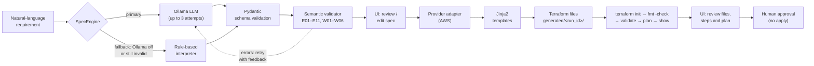
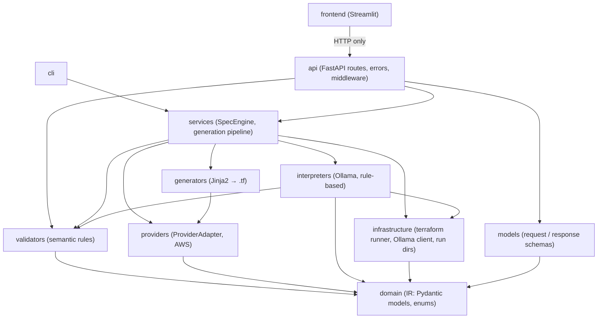

# InfraMorph AI

Turns a plain-English infrastructure requirement into checked AWS Terraform, using a validated intermediate representation (IR) and human approval at the end.

**Status: Milestone 1 complete (AWS)**

## Problem statement

Asking an LLM to write Terraform directly is fragile:

- **Output you can't check.** Free-form HCL can contain made-up resource types, wrong arguments, or insecure settings, and nothing catches them until `terraform plan`, or until a deploy goes wrong.
- **Results you can't repeat.** The same prompt can give different code each time, so there is nothing stable to review, test, or compare.
- **No safety boundary.** Text in the prompt can steer what the model writes, for example "ignore the rules and open all ports".
- **Tied to one cloud.** HCL for `aws_*` cannot be reused for Azure.

InfraMorph puts an **intermediate representation** between the model and Terraform. The LLM only fills in a small, provider-neutral JSON document (4 resource kinds, see [docs/IR_SCHEMA.md](docs/IR_SCHEMA.md)). That document is checked by a Pydantic schema and by semantic rules. Terraform is then **generated deterministically** from it by code and templates. The model never writes Terraform, so everything after the IR can be tested, repeated and audited.

## Features (what works today)

- **4 resource kinds** in the IR: `VirtualNetwork` (with subnets), `SecurityGroup` (with rules), `ComputeInstance`, `StorageBucket`.
- **17 semantic validation rules**: 11 errors (E01–E11) that stop the pipeline and 6 warnings (W01–W06) for insecure or risky settings, e.g. SSH open to `0.0.0.0/0`.
- **Natural language → IR** with a local LLM (Ollama, `qwen2.5:7b`). The output is schema-constrained, and the model gets up to 3 attempts with the validator's errors sent back. A **rule-based fallback** produces the spec when Ollama is off or keeps failing.
- **AWS Terraform generation**, one-to-many: e.g. one `VirtualNetwork` becomes a VPC, subnets, an internet gateway, a route table and associations. Output is byte-identical for the same spec (golden-file tested).
- **Terraform checks**: `init`, `fmt -check`, `validate`, `plan` (offline, with mock credentials) and `show -json`, summarised as "Plan: N to add".
- **FastAPI backend** (`/api/v1`) with one structured error shape, request size limits and OpenAPI docs at `/docs`.
- **Streamlit UI**: describe → specification → review/edit → Terraform → validation & plan → approve.
- **Human approval**: the Approve button unlocks only after a passing plan and an explicit "I have reviewed" check. Nothing is ever applied.

## Architecture

### Pipeline



### Layers



`domain` imports nothing from the other layers. See [backend/ARCHITECTURE.md](backend/ARCHITECTURE.md) for the rules and the reasons behind them.

## Tech stack

| Component | Choice | Why |
|---|---|---|
| Language | Python 3.12 | One language for API, LLM glue and UI; strong typing with Pydantic |
| IR and validation | Pydantic v2 (`extra="forbid"`) | The schema is code: unknown fields are rejected, and the same models give the JSON schema sent to the LLM |
| API | FastAPI + Uvicorn | Request validation and OpenAPI docs come from the same Pydantic models |
| LLM | Ollama + `qwen2.5:7b`, via `httpx` | Free and local, no API key; the REST API supports schema-constrained JSON output |
| Templates | Jinja2 | Deterministic text generation; templates hold layout only, values are escaped by code |
| IaC | Terraform, `hashicorp/aws ~> 5.0` | Industry standard; `fmt`, `validate` and `plan` give independent checks |
| UI | Streamlit | A working review/approval UI in pure Python; it talks to the API over HTTP only |
| Config | pydantic-settings | Typed settings from env vars or `backend/.env`, with defaults that work without either |
| Tests | pytest | Unit, golden-file and opt-in integration tests |

## Installation (Windows, PowerShell)

Run everything from the repository root in PowerShell.

```powershell
# 1. Python 3.12 virtual environment at the repo root
py -3.12 -m venv .venv
.\.venv\Scripts\Activate.ps1      # if blocked: Set-ExecutionPolicy -Scope CurrentUser RemoteSigned

# 2. Backend (editable, with test tools) and frontend dependencies
python -m pip install --upgrade pip
pip install -e ".\backend[dev]"
pip install -r frontend\requirements.txt

# 3. Terraform (needed for validate/plan; without it those steps are skipped)
winget install Hashicorp.Terraform
terraform version

# 4. Ollama and the model (optional; without it the rule-based interpreter is used)
winget install Ollama.Ollama
ollama pull qwen2.5:7b
```

Open a **new** PowerShell window after `winget` so `terraform` and `ollama` are on `PATH`. Configuration is optional. To change the defaults (Ollama URL, model, timeouts), run `Copy-Item backend\.env.example backend\.env` and edit the copy. No cloud credentials are needed or used.

## Usage

### CLI

`pip install -e` puts an `infra-morph` command on the venv's `PATH`. It works from any folder.

```powershell
.\.venv\Scripts\Activate.ps1

# Requirement -> validated spec (JSON on stdout; notes and warnings on stderr)
infra-morph interpret "Create an AWS VPC with a public subnet and web server." > $env:TEMP\spec.json

# Spec file -> Terraform + init/fmt/validate/plan report
infra-morph generate-from-spec $env:TEMP\spec.json

# Both in one go
infra-morph interpret "Create an AWS storage bucket with versioning." --generate
```

Exit code 0 means every step passed or was skipped. 1 means invalid input or a failed step. Generated files go to `backend\generated\<run_id>\`.

### API

```powershell
.\.venv\Scripts\Activate.ps1
cd backend
uvicorn app.main:app --port 8000
```

Interactive docs: http://127.0.0.1:8000/docs. In a second window, from the repo root (use `curl.exe`: in Windows PowerShell, `curl` is an alias for `Invoke-WebRequest`):

```powershell
curl.exe -X POST http://127.0.0.1:8000/api/v1/specifications/validate `
  -H "Content-Type: application/json" `
  --data-binary "@backend/tests/fixtures/specs/demo2.json"
```

```json
{"is_valid":true,"errors":[],"warnings":[{"code":"W01","severity":"warning","message":"SSH (port 22) is open to the whole internet (0.0.0.0/0) on web-sg rule #3 (inbound tcp); restrict it to your own IP range","resource_name":"web-sg"}]}
```

All endpoints, request/response examples and error codes are in [docs/API.md](docs/API.md).

### UI

Use two PowerShell windows, both started at the repo root.

```powershell
# Window 1: backend (FastAPI, port 8000)
.\.venv\Scripts\Activate.ps1
cd backend
uvicorn app.main:app --port 8000
```

```powershell
# Window 2: frontend (Streamlit, port 8501)
.\.venv\Scripts\Activate.ps1
streamlit run frontend\app.py
```

Open http://localhost:8501. The sidebar shows whether the backend and Terraform are available. To use a different backend, set `$env:BACKEND_URL = "http://host:port"` before `streamlit run`.

## Example: Demo 2

**Prompt:** *Create an AWS VPC with a public subnet and web server.*

**Spec** (from one real run of `qwen2.5:7b`, produced on the first attempt; excerpt):

```json
{
  "schema_version": "1", "name": "vpc-with-web-server", "provider": "aws",
  "region": "us-east-1", "environment": "dev", "tags": {},
  "resources": [
    { "kind": "VirtualNetwork", "name": "web-vpc", "cidr": "10.0.0.0/16",
      "subnets": [ { "name": "public-a", "cidr": "10.0.1.0/24", "public": true } ] },
    { "kind": "SecurityGroup", "name": "web-sg", "network": "web-vpc",
      "rules": [ { "direction": "inbound", "protocol": "tcp", "from_port": 80,  "to_port": 80,  "cidr": "0.0.0.0/0", "description": "HTTP" },
                 { "direction": "inbound", "protocol": "tcp", "from_port": 443, "to_port": 443, "cidr": "0.0.0.0/0", "description": "HTTPS" } ] },
    { "kind": "ComputeInstance", "name": "web-server", "size": "small", "os": "ubuntu",
      "subnet": "web-vpc.public-a", "security_groups": ["web-sg"], "public_ip": true }
  ]
}
```

**Terraform** (`main.tf` excerpt). The group has no outbound rule, so the adapter adds the default egress rule that Terraform would otherwise remove:

```hcl
resource "aws_instance" "web_server" {
  ami                         = local.ubuntu_ami_ids["us-east-1"]
  instance_type               = "t3.micro"
  subnet_id                   = aws_subnet.web_vpc_public_a.id
  vpc_security_group_ids      = [aws_security_group.web_sg.id]
  associate_public_ip_address = true
  ...
}

resource "aws_vpc_security_group_egress_rule" "web_sg_egress_default" {
  security_group_id = aws_security_group.web_sg.id
  ip_protocol       = "-1"
  cidr_ipv4         = "0.0.0.0/0"
  description       = "Allow all outbound traffic (default)"
  ...
}
```

**Checks:**

```text
PASSED   terraform init (1.2s)
PASSED   terraform fmt (0.1s)
PASSED   terraform validate (10.2s)
PASSED   terraform plan (2.4s)
PASSED   terraform show (1.7s)
Plan: 10 to add, 0 to change, 0 to destroy.
```

The 10 resources are VPC, subnet, internet gateway, route table, route table association, security group, 2 ingress rules, 1 egress rule and the instance.

## Testing

```powershell
.\.venv\Scripts\Activate.ps1

pytest -q                     # from the repo root: backend + frontend tests (no Ollama, no terraform needed)
pytest -m integration -q      # real terraform (first run downloads the AWS provider) and a live Ollama

python backend\scripts\run_demos.py               # demos 1, 2, 3, 5 end to end (Ollama, with fallback)
python backend\scripts\run_demos.py --rule-based  # same, rule-based interpreter only
```

- The default run excludes `integration` tests (set in `pytest.ini`), so it passes on a clean clone with no `.env`, Ollama or Terraform. Ollama is mocked with `httpx.MockTransport`, and Terraform with a fake runner.
- Golden files (`backend/tests/fixtures/golden/demo2/`) pin the exact generated Terraform.
- `run_demos.py` prints a table (interpreter, attempts, warnings, validate, plan to_add). It exits with 1 if any demo fails.

## Security

- **LLM output is untrusted.** Every candidate spec goes through the same JSON parse → Pydantic (`extra="forbid"`) → semantic validation as a hand-written one (`interpreters/base.py: check_candidate`). A spec with errors is never returned. The provider chosen by the user always overrides the model's choice.
- **Prompt-injection delimiting.** The system prompt is fixed. User text only appears inside a `<requirement>` block, and any `<requirement>` tags typed by the user are removed so the block can't be closed early. Whatever the text says, the result is validated, and insecure rules still raise warnings.
- **Insecure settings are flagged.** Warnings cover SSH/RDP/all ports open to `0.0.0.0/0`, public buckets, instances without a security group, and prod buckets without versioning.
- **Terraform allowlist.** Only `init`, `fmt`, `validate`, `plan` and `show` can run. `apply`, `destroy`, `import`, `state` and every other subcommand raise an error before anything runs.
- **No shell.** Commands run as argument lists (`subprocess.run([...])`), never with `shell=True`.
- **Timeouts on everything.** 120 s for `init`, 60 s for the other Terraform commands, 120 s for Ollama. A timeout is reported as a step status.
- **Isolated run directories.** Each run gets a fresh `backend/generated/<timestamp>-<random>/`, created with `exist_ok=False`, and Terraform runs with that directory as `cwd`.
- **Cloud credentials stripped.** Every `AWS_*`, `ARM_*` and `AZURE_*` variable is removed from Terraform's environment, so real credentials on the machine can never be used.
- **Mock provider credentials.** The generated provider block uses `access_key = "mock"` plus `skip_credentials_validation`, `skip_requesting_account_id` and `skip_metadata_api_check`, and the config has no data sources. The plan never contacts AWS.
- **Generated HCL is escaped.** Every string value is quoted and escaped by code. Only adapter code can emit a raw expression, never user text.
- **No secrets in the repo.** `.env`, `*.tfvars` and `*.tfstate` are gitignored, and `.env.example` has no secrets. Prompts and model answers are logged at DEBUG only.
- **Request limits.** The request body can be at most 100,000 bytes (413), a spec at most 50 resources, and a requirement at most 2,000 characters (422). Only one generation runs at a time (409).

## Known limitations

- **The rule-based fallback ignores counts.** "Two web servers" gives one compute instance, and no warning says so.
- **AMI IDs are examples.** The AMI comes from a `locals` map of region → example Ubuntu 22.04 AMI ID, merged with an optional `ubuntu_ami_overrides` variable. This lets the plan run offline without data sources. Before a real deploy, set the override to current AMIs for the chosen region.
- **Bucket names must be globally unique on a real deploy.** S3 names are global. The plan runs with mock credentials, so it cannot detect a name that is already taken.
- **Azure plan needs a real login.** Even when Azure generation is added, it will stop at `terraform fmt` and `validate`. `terraform plan` for `azurerm` needs real Azure credentials, which this project does not use.
- **Milestone 2 work:** Azure generation and cost estimation (Infracost) are not in Milestone 1. The approval is held in the Streamlit session only; a persistent approval record is Milestone 2.
- **Deployment is out of scope by design.** InfraMorph never runs `terraform apply` or `terraform destroy`. A plan is the furthest it goes.

## Roadmap (Milestone 2, due 30 Nov 2026)

- **Azure adapter and templates**: resource group, VNet/subnets, NSG and rules, NIC + public IP + Linux VM, storage account + container, with `fmt` and `validate` (Demo 4). Enable Azure in the UI.
- **Cost estimation**: run Infracost on the run directory when `infracost` is installed and `INFRACOST_API_KEY` is set, otherwise show "Cost estimation unavailable". Prices are never invented.
- **Persistent approval record**: written per run (who, when, which run ID and plan), still without any apply.
- **Future scope**: more resource kinds (load balancer, database), a GCP adapter, an LLM evaluation set, and the academic project report.
