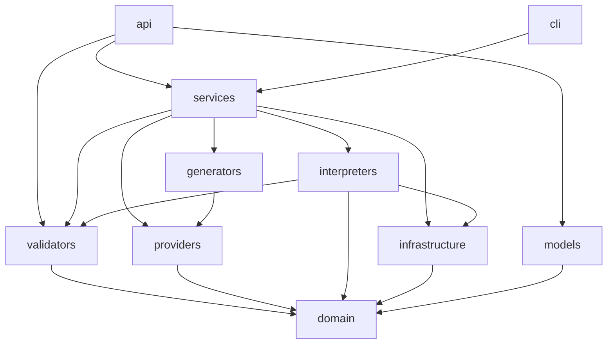

# InfraMorph AI — Backend Architecture

This describes the code as it is at Milestone 1 (AWS end to end). The IR is specified in [../docs/IR_SCHEMA.md](../docs/IR_SCHEMA.md) and the HTTP API in [../docs/API.md](../docs/API.md).

## 1. Overview

```text
requirement (text)
  -> interpreters/  Ollama LLM (primary) | rule-based (fallback)     [services/spec_engine.py]
  -> domain/        Pydantic IR: InfrastructureSpecification
  -> validators/    semantic rules E01–E11 (errors), W01–W06 (warnings)
  -- user reviews / edits the spec (UI or a JSON file) --
  -> providers/     ProviderAdapter.build_context(spec) -> RenderContext   (one-to-many)
  -> generators/    Jinja2 templates -> providers.tf, main.tf, variables.tf, outputs.tf
  -> infrastructure/ write to generated/<run_id>/, terraform init -> fmt -check -> validate -> plan -> show -json
  -> PlanSummary (to_add / to_change / to_destroy) -> human approval (UI); never apply
```

Two separate requests make the human the checkpoint: `POST /specifications` stops at a validated spec, and `POST /generate` starts from a spec the user has seen and may have edited.

## 2. Package layout (`backend/app/`)

| Package | Responsibility | Key files |
|---|---|---|
| `domain/` | The IR and core types. Pydantic only; no FastAPI, Jinja2, httpx or subprocess | `spec.py` (InfrastructureSpecification), `resources.py` (the 4 kinds, discriminated by `kind`), `enums.py`, `validation.py` (ValidationIssue/Result), `terraform.py` (CommandResult, CommandStatus, PlanSummary) |
| `validators/` | Semantic validation as pure functions over the IR | `semantic.py`: `validate(spec) -> ValidationResult`, `ALLOWED_REGIONS` |
| `providers/` | IR → provider-specific Terraform resources (as data, not text). The only Python code that names `aws_*` resources | `base.py` (ProviderAdapter, RenderContext, Expression, …), `aws.py` (AWSProvider), `registry.py` (`get_provider`; Azure raises UnsupportedProviderError) |
| `generators/` | RenderContext → `.tf` text with Jinja2 | `terraform_generator.py`, `hcl.py` (quoting/escaping filters), `templates/aws/*.tf.j2` |
| `interpreters/` | Natural language → candidate IR → checked spec | `base.py` (SpecInterpreter, `check_candidate`), `ollama_interpreter.py`, `rule_based.py` |
| `infrastructure/` | External I/O | `terraform_runner.py` (allowlisted subprocess), `ollama_client.py` (httpx → `/api/chat`), `workspace.py` (per-run directories) |
| `services/` | Orchestration | `spec_engine.py` (primary + fallback), `generation.py` (validate → generate → terraform checks), `health.py` |
| `models/` | API request/response schemas (transport types) | `specifications.py`, `interpretation.py`, `generation.py`, `errors.py`, `health.py` |
| `api/` | FastAPI routes, error mapping, middleware; no business logic in handlers | `v1/*.py`, `errors.py`, `middleware.py` (body size limit), `dependencies.py` |
| `cli/` | `infra-morph` command (version, generate, generate-from-spec, interpret) | `main.py` |
| `core/` | Settings and version | `config.py` (pydantic-settings, paths), `version.py` |

The frontend (`frontend/app.py`, Streamlit) is a separate program that talks to the API over HTTP only (`frontend/api_client.py`).

## 3. Dependency rules



These match the actual imports:

- **`domain` imports nothing from `app`.** Everything depends on it, and it depends on nothing, so the IR can be reasoned about and tested on its own.
- **`validators` and `providers` depend only on `domain`.** Validation never knows about Terraform, and the adapters never know about Jinja2 or subprocess.
- **`generators` depends only on `providers.base`**, which holds the RenderContext data types. It never sees the IR.
- **Only `infrastructure` does external I/O** (subprocess, HTTP, filesystem layout). `interpreters` reach Ollama only through `infrastructure.ollama_client`.
- **`services` is the only layer that wires everything together.** `api` and `cli` are thin entry points over it. `api` also calls `validators.validate` directly for `/specifications/validate`, and imports `providers.registry` for its exception type.
- **`models` may reference `domain` and service result types, but `domain` never imports `models`.** The HTTP contract (e.g. the 50-resource limit) can change without touching the IR.
- `core` (settings) may be imported by any layer except `domain`.

## 4. Provider mapping (one-to-many)

An adapter turns each IR resource into several Terraform resources. On AWS:

| IR resource | AWS Terraform resources |
|---|---|
| VirtualNetwork | `aws_vpc` + one `aws_subnet` per subnet; if any subnet is public: `aws_internet_gateway` + `aws_route_table` (0.0.0.0/0 → IGW) + one `aws_route_table_association` per public subnet |
| SecurityGroup | `aws_security_group` + one `aws_vpc_security_group_ingress_rule` / `_egress_rule` per rule; a default allow-all egress rule if the group has no outbound rule (Terraform removes AWS's implicit one) |
| ComputeInstance | `aws_instance`. The AMI comes from `local.ubuntu_ami_ids[<region>]`: a `locals` map of example AMI IDs merged with `var.ubuntu_ami_overrides`. Instance type from size: small/medium/large → t3.micro/small/medium |
| StorageBucket | `aws_s3_bucket` + `aws_s3_bucket_versioning` + `aws_s3_bucket_public_access_block` |

Every taggable resource gets `Name`, `Environment` and `ManagedBy = "inframorph"`, merged with the spec's tags. Outputs are derived automatically: VPC/subnet IDs, instance private/public IP and bucket name.

The adapter returns a `RenderContext` (provider config, locals, variables, resources, outputs) made of plain dataclasses. References between resources are `Expression` objects (e.g. `aws_vpc.main_vpc.id`). Every plain `str` is rendered quoted and escaped. `check_unique_addresses` rejects two IR names that would map to the same Terraform address (`a-b`+`c` vs `a`+`b-c`).

Azure is planned for Milestone 2 behind the same `ProviderAdapter` interface (mapping in IR_SCHEMA §7). Today `get_provider("azure")` raises `UnsupportedProviderError`, and the API returns 400 for it.

## 5. Generation pipeline (`services/generation.py`)

1. `get_provider(spec.provider)`. An unsupported provider fails before any file is written.
2. Take a process-wide lock. A second concurrent call raises `PipelineBusyError` (HTTP 409) rather than waiting.
3. `validate(spec)`. If there are errors, stop: no run directory is created and Terraform is not run.
4. `new_run_dir()` creates `backend/generated/<UTC timestamp>-<6 hex>/` with `exist_ok=False`.
5. Adapter → RenderContext → Jinja2 → 4 files, written with `\n` line endings.
6. `terraform init -backend=false` → `fmt -check -diff` → `validate` → `plan -out=plan.tfplan` → `show -json plan.tfplan`. The pipeline stops at the first failed or timed-out step. A missing `terraform` gives SKIPPED steps.
7. The `show -json` output is parsed into a `PlanSummary` (to_add, to_change, to_destroy, resource addresses).

The terraform runner (`infrastructure/terraform_runner.py`) enforces the safety rules: an allowlist (`init`, `fmt`, `validate`, `plan`, `show`), argument lists without a shell, a timeout on every command, `cwd` = the run directory, and an environment with all `AWS_*`/`ARM_*`/`AZURE_*` variables removed. Each command records its command, exit code, stdout, stderr, duration and status.

## 6. Interpretation (`services/spec_engine.py`, `interpreters/`)

- `SpecInterpreter.interpret(requirement, provider) -> InterpretationResult` never raises for bad input. It reports `success`, `unavailable` or `failed`, with errors and notes.
- `check_candidate(data, provider)` is the only way a candidate becomes a spec. It forces the user's provider, then runs Pydantic, the resource limit and semantic validation. Warnings pass; errors fail.
- **OllamaInterpreter**: fixed system prompt; user text inside `<requirement>` with injected tags removed; the IR's JSON schema passed as Ollama's `format`; `temperature 0`; up to 3 attempts, each retry sending back up to 15 validator errors.
- **RuleBasedInterpreter**: keywords and regexes → fixed templates. It is deterministic, uses secure defaults (SSH only from inside the network unless a source or "anywhere" is stated), and lists unsupported requests (databases, k8s, …) in `notes`.
- **SpecEngine**: tries Ollama first. If Ollama is *unavailable*, or *failed* after all attempts, it runs the rule-based interpreter and records `fallback_reason`.

## 7. Design decisions and why

**IR first.** The LLM fills in a small, closed schema (4 kinds, enums, `extra="forbid"`) instead of writing HCL. A closed schema can be validated completely, reviewed by a person, edited, stored as a test fixture and mapped to more than one cloud. The model's output is just untrusted input to the same validator a hand-written spec goes through.

**Deterministic generation.** Adapters emit resources in IR order with fixed expansion order. The generator writes a fixed set of files with `\n` line endings, and there are no timestamps or random IDs in the output. The same spec gives byte-identical Terraform on Windows and Linux. That makes golden-file tests possible (`tests/fixtures/golden/demo2/`), and any change to the output shows up as a reviewable diff.

**Mock-credential plan.** A real `terraform plan` is the strongest check available without deploying, but the project has no cloud account. The AWS provider block uses fake keys with `skip_credentials_validation`, `skip_requesting_account_id` and `skip_metadata_api_check`, and the config has no data sources (the AMI is a locals map, not an `aws_ami` lookup). The plan then runs fully offline. As a safeguard, the runner removes real credentials from the environment. The price is that plan cannot catch problems only AWS knows about (taken bucket names, invalid AMIs).

**Shared Terraform data dir.** Every run uses one `TF_DATA_DIR` (`backend/.terraform-shared/`). On Windows, Terraform cannot symlink from a plugin cache, so each run used to copy the AWS provider (hundreds of MB), and antivirus scanned every copy. Now the provider is installed once. The lock file from the first successful `init` is saved and seeded into each new run, so later inits only verify. The `.tf` files and `plan.tfplan` stay in the run directory, so runs remain isolated. Because the data dir is shared, Terraform commands are serialised by a process-wide lock, and only one pipeline runs at a time (409 for a second one).

**Rule-based fallback.** Ollama on a laptop CPU is slow (≈ 1 minute) and might not be running. The demo and the tests must not depend on it. The fallback goes through the same `check_candidate`, so it cannot produce anything the LLM path couldn't. It also gives a deterministic baseline to compare the LLM against (`scripts/run_demos.py --rule-based`).

**Separate interpret and generate steps.** Generating Terraform from an unreviewed LLM answer would hide the most error-prone step. The user sees the spec, its warnings and the interpreter used, then decides to generate.

**A failed Terraform step is still HTTP 200.** The request worked, but the infrastructure did not pass. The response carries every step's output so the failure can be shown, not hidden. HTTP errors are kept for bad requests (422/400/413), conflicts (409) and server bugs (500).

## 8. Tests (`backend/tests/`)

- `unit/`: domain, validator rules, AWS adapter, HCL escaping, generator, golden files, terraform runner (fake subprocess), Ollama client/interpreter (`httpx.MockTransport`), rule-based interpreter, SpecEngine, API routes and errors, CLI.
- `integration/` (marker `integration`, excluded by default): the real terraform pipeline on the fixture specs, and a live Ollama call.
- `fixtures/`: demo specs (`specs/demo1|2|5.json`), golden Terraform (`golden/demo2/`), a recorded `terraform show -json`.
